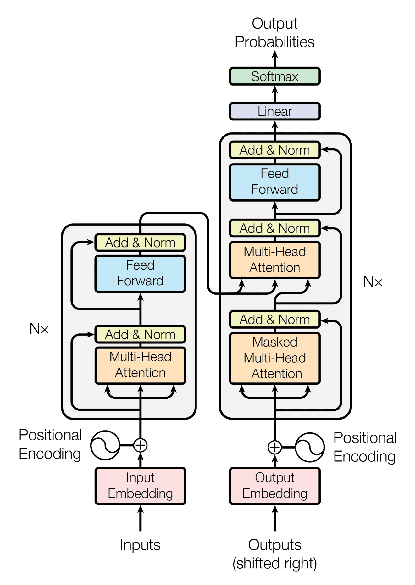

# Transformer Model from Scratch in PyTorch

This repository contains a complete implementation of the original Transformer model from the paper "Attention Is All You Need," built from scratch using PyTorch. The code is designed to be clear, modular, and easy to follow for educational purposes.

---

## 📚 Detailed Explanation

For a deeper dive into the theory and code, please refer to my articles on Medium:

- [Model Explanation part 1](https://medium.com/data-science/all-you-need-to-know-about-attention-and-transformers-in-depth-understanding-part-1-552f0b41d021)
- [Model Explanation part 2](https://medium.com/data-science/all-you-need-to-know-about-attention-and-transformers-in-depth-understanding-part-2-bf2403804ada)
- [Code Explanation](https://medium.com/towards-data-science/build-your-own-transformer-from-scratch-using-pytorch-84c850470dcb)

---

## 🏛️ Understanding the Transformer Architecture

The Transformer is a revolutionary deep learning architecture that relies entirely on **self-attention mechanisms**, discarding the recurrence and convolutions used in previous sequence-to-sequence models like RNNs and LSTMs. This allows for significantly more parallelization and has become the foundation for most modern large language models (LLMs).

The model consists of two main parts: an **Encoder** and a **Decoder**.



### Key Components

1.  **Input Embeddings & Positional Encoding**
    -   **Input Embeddings**: Like other NLP models, the Transformer converts input tokens (words) into dense vectors of a fixed size (`d_model`).
    -   **Positional Encoding**: Since the model has no inherent sense of sequence order, we inject information about the position of each token. This is done by adding a vector calculated using sine and cosine functions of different frequencies.

2.  **The Encoder**
    The encoder's job is to process the entire input sequence and build a rich contextual representation of it. It's a stack of identical `N` layers, where each layer has two main sub-layers:
    -   **Multi-Head Self-Attention**: This is the core of the Transformer. It allows each token in the input sequence to look at and weigh the importance of all other tokens in the sequence. "Multi-head" means it does this multiple times in parallel across different "representation subspaces," allowing it to focus on different aspects of the sequence (e.g., one head might focus on syntactic relationships, another on semantic ones).
    -   **Feed-Forward Network**: A simple, fully connected neural network applied independently to each token's representation. It processes the output of the attention layer.

3.  **The Decoder**
    The decoder's job is to generate the output sequence one token at a time, using the encoder's output as context. It is also a stack of `N` identical layers and has three sub-layers:
    -   **Masked Multi-Head Self-Attention**: Similar to the encoder's attention, but with a crucial difference: it's "masked." This prevents each token from "seeing" future tokens in the output sequence it is trying to generate, which would be cheating.
    -   **Cross-Attention (Encoder-Decoder Attention)**: This is where the decoder gets its context from the encoder. The queries (`Q`) come from the decoder's masked attention layer, while the keys (`K`) and values (`V`) come from the final output of the encoder. This allows the decoder to focus on the most relevant parts of the *input* sequence to predict the next *output* token.
    -   **Feed-Forward Network**: Identical in structure to the one in the encoder.

4.  **Residual Connections & Layer Normalization**
    -   Each sub-layer in both the encoder and decoder is wrapped with a **residual connection** (the input to the layer is added to its output) followed by **layer normalization**. This helps stabilize the training of deep networks and improves the flow of gradients.

---

## 📂 Project Structure

```
.
├── transformers.py                  # The complete Transformer implementation with early stopping and model save/load
├── Transformers in Pytorch.ipynb    # The complete Transformer implementation as jupyter notebook
├── test_model.py                    # Comprehensive test suite for the Transformer model
├── run_test.py                      # Standalone test script
├── requirements.txt                 # Python dependencies
└── README.md                        # This file
```

---

## 🚀 Installation

1.  **Clone the Repository**
    ```bash
    git clone https://github.com/as4401s/Transformers-in-Pytorch.git
    cd Transformers-in-Pytorch
    ```

2.  **Install Dependencies**

    Using `uv` (recommended):
    ```bash
    uv venv
    source .venv/bin/activate  # On Windows: .venv\Scripts\activate
    uv pip install -r requirements.txt
    ```

    Or using `pip`:
    ```bash
    pip install -r requirements.txt
    ```

## 🧪 Testing

Run the comprehensive test suite to verify everything works:

```bash
# Activate virtual environment (if using uv)
source .venv/bin/activate

# Run tests
python run_test.py
```

The test suite verifies:
- ✅ Model creation and parameter counting
- ✅ Forward pass with correct output shapes
- ✅ Mask generation
- ✅ Training step (forward + backward)
- ✅ Model saving and loading
- ✅ Early stopping mechanism
- ✅ Gradient flow (no NaN gradients)

## 🚀 How to Use

1.  **Import and Build the Model**
    You can import the `build_transformer` function from `transformers.py` and create an instance with your desired parameters.

    ```python
    import torch
    from transformers import build_transformer

    # Example parameters
    src_vocab_size = 10000
    tgt_vocab_size = 10000
    src_seq_len = 128
    tgt_seq_len = 128
    d_model = 512 # Dimension of the model (embeddings)
    N = 6         # Number of encoder/decoder layers
    h = 8         # Number of attention heads
    dropout = 0.1
    d_ff = 2048   # Hidden dimension of the feed-forward network

    # Build the model
    model = build_transformer(src_vocab_size, tgt_vocab_size, src_seq_len, tgt_seq_len, d_model, N, h, dropout, d_ff)

    # Example dummy input
    src = torch.randint(0, src_vocab_size, (1, src_seq_len)) # (batch_size, seq_len)
    tgt = torch.randint(0, tgt_vocab_size, (1, tgt_seq_len)) # (batch_size, seq_len)

    # You would also need to create appropriate masks for a real use case
    src_mask = torch.ones(1, 1, src_seq_len)
    tgt_mask = torch.ones(1, tgt_seq_len, tgt_seq_len)

    # Forward pass - Option 1: Using encode/decode/project methods
    encoder_output = model.encode(src, src_mask)
    decoder_output = model.decode(encoder_output, src_mask, tgt, tgt_mask)
    final_output = model.project(decoder_output)

    # Forward pass - Option 2: Using the forward() method (automatically handles masks)
    final_output = model(src, tgt)

    print("Model built successfully!")
    print("Final output shape:", final_output.shape) # (batch_size, seq_len, tgt_vocab_size)
    ```

---

## ✨ Features

This implementation includes several practical features for training:

- ✅ **Complete Transformer Architecture** - Full encoder-decoder implementation from scratch
- ✅ **Early Stopping** - Automatically stop training when validation loss stops improving
- ✅ **Model Checkpointing** - Save and load trained models with optimizer state
- ✅ **Comprehensive Testing** - Test suite to verify all functionality
- ✅ **Clean, Modular Code** - Well-documented and easy to understand

---

## 🎯 Training Features

### Early Stopping

The codebase includes an `EarlyStopping` class to automatically stop training when the model stops improving. This helps prevent overfitting and saves computational resources.

```python
from transformers import EarlyStopping

# Initialize early stopping
early_stopping = EarlyStopping(
    patience=10,              # Number of epochs to wait before stopping
    min_delta=0.001,         # Minimum change to qualify as improvement
    restore_best_weights=True,  # Restore best model weights when stopping
    verbose=True             # Print early stopping messages
)

# In your training loop
for epoch in range(num_epochs):
    # ... training code ...
    val_loss = validate_model()  # Your validation loss
    
    if early_stopping(val_loss, model):
        print("Training stopped early!")
        break
```

### Model Saving and Loading

Save your trained models to disk for later use or to resume training:

```python
from transformers import save_model, load_model
import torch.optim as optim

# Save a model
save_model(
    model=transformer,
    optimizer=optimizer,
    epoch=epoch,
    loss=loss_value,
    filepath="checkpoints/best_model.pth",
    additional_info={'best_loss': best_loss}  # Optional: save extra info
)

# Load a saved model
loaded_model = Transformer(...)  # Create model with same architecture
loaded_optimizer = optim.Adam(loaded_model.parameters(), ...)

checkpoint = load_model(
    model=loaded_model,
    optimizer=loaded_optimizer,
    filepath="checkpoints/best_model.pth",
    device=torch.device('cuda' if torch.cuda.is_available() else 'cpu')
)

# Continue training or use for inference
```

The saved checkpoint includes:
- Model state dictionary (weights)
- Optimizer state dictionary
- Current epoch number
- Loss value
- Any additional information you provide

---

## 📝 Example Training Loop

Here's a complete example showing how to use early stopping and model saving:

```python
import torch
import torch.nn as nn
import torch.optim as optim
from transformers import EarlyStopping, save_model, load_model

# ... model setup ...

criterion = nn.CrossEntropyLoss(ignore_index=0)
optimizer = optim.Adam(model.parameters(), lr=0.0001)

# Initialize early stopping
early_stopping = EarlyStopping(patience=10, min_delta=0.001, verbose=True)

# Training loop
best_loss = float('inf')
for epoch in range(num_epochs):
    # Training step
    model.train()
    train_loss = train_one_epoch(model, train_loader, criterion, optimizer)
    
    # Validation step
    model.eval()
    val_loss = validate(model, val_loader, criterion)
    
    # Save best model
    if val_loss < best_loss:
        best_loss = val_loss
        save_model(model, optimizer, epoch, val_loss, "checkpoints/best_model.pth")
    
    # Check early stopping
    if early_stopping(val_loss, model):
        break
```

---

## 📋 Requirements

- Python 3.8+
- PyTorch 2.0.0+
- NumPy 1.20.0+

Install all dependencies using:
```bash
pip install -r requirements.txt
```

---

## 🤝 Contributing

Contributions are welcome! If you find any issues or have suggestions for improvements, please feel free to open an issue or submit a pull request.

---

## 📄 License

This project is open source and available for educational purposes.

---

